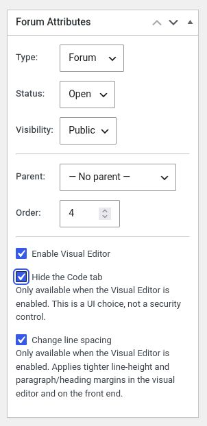

# Gator-Gate-Pre for bbPress

**A lightweight, targeted approach to preformatted content and front-end editing in bbPress.**

## Overview

Gator-Gate-Pre adds a robust preformatted code block function to the Gator-Gate Editor for bbPress. It provides forum users with a simple and reliable way to insert and work with preformatted text directly within the TinyMCE Visual Editor.

The objective is simple: provide bbPress with a clean, controlled and lightweight way to handle preformatted content while preserving the underlying philosophy of Gator Gate — modular features, minimal overhead and practical functionality without unnecessary complexity.

## Key Features

- **Preformatted Code Blocks:** A dedicated function for inserting and working with preformatted text directly within the Visual Editor.
- **Per-Forum Visual Editor Control:** Administrators can enable or disable the TinyMCE Visual Editor independently for each forum using a simple checkbox.
- **Targeted Editor Integration:** Changes are restricted to the front-end bbPress topic and reply editors.
- **WordPress Admin Isolation:** The standard WordPress administration post and page editor is left untouched.
- **Lightweight Implementation:** Avoids unnecessary global modifications and keeps functionality focused on where it is needed.

## Per-Forum Visual Editor Control

One of the useful features of Gator-Gate-Pre is the ability to enable or disable the TinyMCE Visual Editor on a per-forum basis.

Rather than forcing the Visual Editor on every forum or requiring additional plugins and complicated configuration, Gator Gate gives administrators a simple checkbox to control where visual editing is available.

This provides flexibility for different types of discussions:

- Forums that benefit from visual editing can have it enabled.
- Forums intended for plain text, code or more technical discussions can keep it disabled.

This gives administrators meaningful control over the editing experience without unnecessarily changing the wider WordPress environment.

## A Practical Example of Design Refactoring

For the initial proof of concept, we were using more global hooks than necessary. WordPress can load TinyMCE editors in both the administration area and on the front end, but these are separate editor instances with different IDs, toolbars and configurations.

The more targeted approach is to work directly with the bbPress topic and reply editors, leaving the standard WordPress administration post and page editor untouched.

Keeping the changes contained reduces the risk of unintended side effects, helps maintain compatibility with other plugins and WordPress updates, and avoids interfering with unrelated editing workflows.

It's a deliberate trade-off: improve the experience where it's needed while minimising the impact on the wider WordPress environment.

### Editor Targeting

Editor targeting:

Front-end topic/reply
- Location: Front-end bbPress form
- Editor type: bbPress custom form
- Editor ID: `bbp_topic_content` / `bbp_reply_content`
- Gets Table button? Yes

Admin — create/edit forum
- Location: WordPress admin
- Editor type: Standard WordPress editor
- Editor ID: `content`
- Gets Table button? No

## The Gator Gate Philosophy: The 90/10 Principle

Our philosophy is to solve the 90% use case simply and reliably, recognising that the final 10% often brings diminishing returns and additional overhead.

**Maximum practical benefit, minimum unnecessary complexity.**

Rather than introducing complicated configuration, additional dependencies or broad changes to WordPress, Gator Gate focuses on delivering practical functionality where it provides the greatest benefit.

The per-forum Visual Editor is a good example of this approach. A simple checkbox provides administrators with meaningful control without requiring a complicated configuration system.

Likewise, targeting the bbPress editors specifically achieves the desired front-end improvements without unnecessarily modifying the standard WordPress administration editor.

It's a straightforward design philosophy: solve the problem where it exists, rather than changing things that don't need changing.

## Design Principles

Gator Gate is built around a few straightforward principles:

- **Modularity:** Features are developed as focused components rather than unnecessarily expanding the core functionality.
- **Minimal Overhead:** Avoid unnecessary hooks, dependencies and complexity.
- **Targeted Integration:** Make changes only where they are required.
- **Practical Functionality:** Prioritise features that deliver meaningful improvements to the user experience.
- **Stability:** Minimise interference with WordPress core functionality and unrelated plugins.

## Another Example of Design Efficiency: Reusing WordPress Metadata

Another example of the Gator Gate approach is how we store the per-forum checkbox settings.

Rather than creating a separate database table or introducing another storage mechanism, Gator Gate piggybacks on the existing WordPress forum post metadata. This is actually an appropriate place to store per-forum information. 

WordPress already provides a metadata system for storing additional information against individual posts, including bbPress forums. It also provides metadata caching, allowing these saved settings to benefit from WordPress's existing caching infrastructure.

This gives us several practical advantages:

- **No Additional Database Table:** Settings are stored alongside the existing forum metadata.
- **Efficient Retrieval:** We can reuse WordPress's native metadata API and its associated caching rather than introducing a separate settings lookup system.
- **Automatic Association:** Each setting belongs directly to its relevant forum.
- **Simpler Maintenance:** No additional database schema or custom storage layer is required.
- **Natural Cleanup:** When a forum is deleted through the normal WordPress deletion process, its associated post metadata is also cleaned up.

It's another example of avoiding unnecessary infrastructure. Instead of building a new system to solve a relatively simple problem, we take advantage of functionality WordPress already provides.

**Reuse what's already there, avoid unnecessary overhead, and keep the implementation lean.**

---

### Archived Project – Historical Reference

This project was originally distributed as standalone PHP code snippets and has since been developed into a standalone WordPress plugin, which is currently awaiting WordPress.org review.

The original PHP snippets and plugin files are retained here for historical and reference purposes only. They may receive periodic updates but are not actively maintained or recommended for installation.

As the project is released under the GPL licence, the archived source code remains available for others to explore, learn from, modify or incorporate into their own projects, in accordance with the licence terms. Hopefully, others may find elements of the code useful or build upon the work.

Once approved, a link to the official WordPress.org plugin page will be provided here.

Users currently running the original snippets or archived plugin should migrate to the official release and can remove the older versions from their websites.

### Licensed
Licensed under GPL v2 or later.

AI-generated and AI-assisted code is provided AS IS without warranty. Users are responsible for testing and validating the code before deploying it in production environments.

## ☕ Voluntary Support
[tinfoilwho.com](https://tinfoilwho.com/mission-support/)

